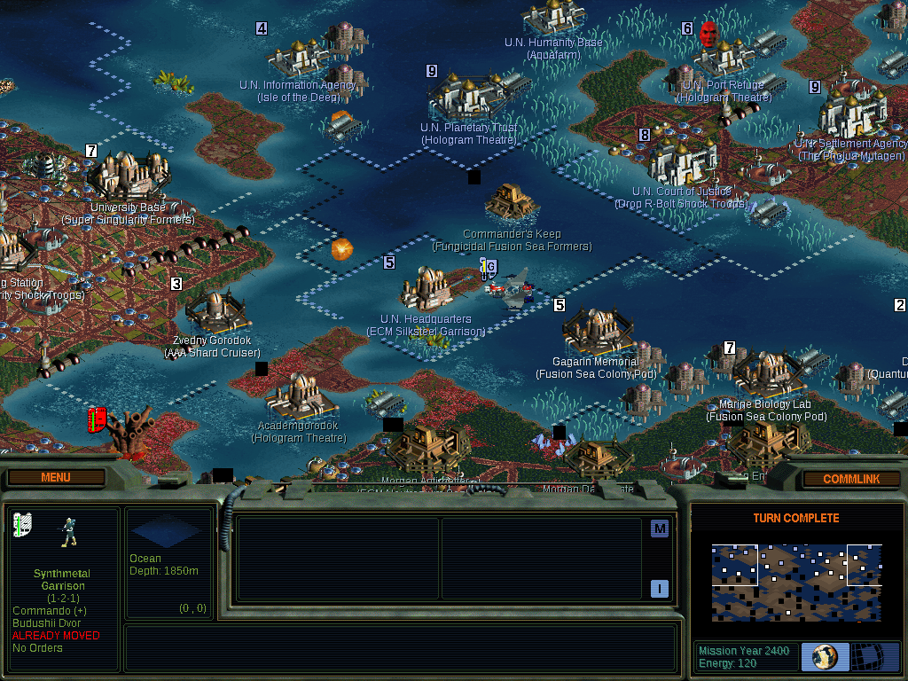
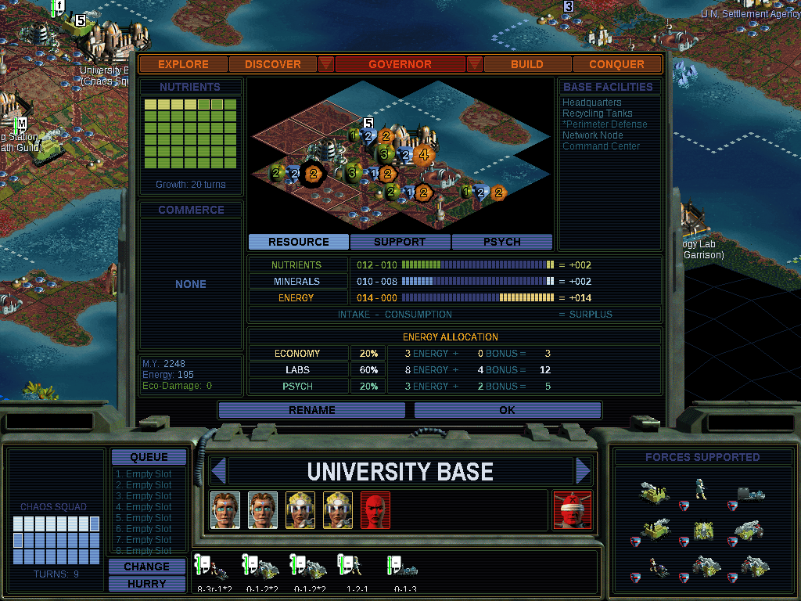
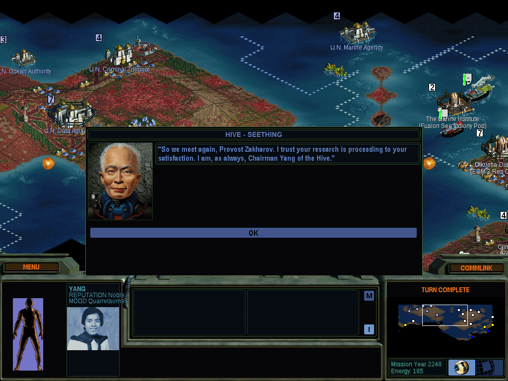
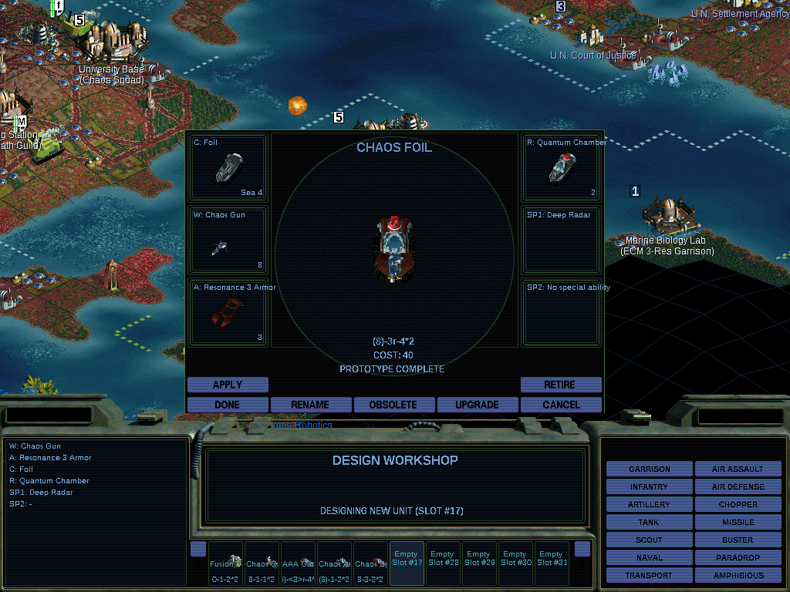
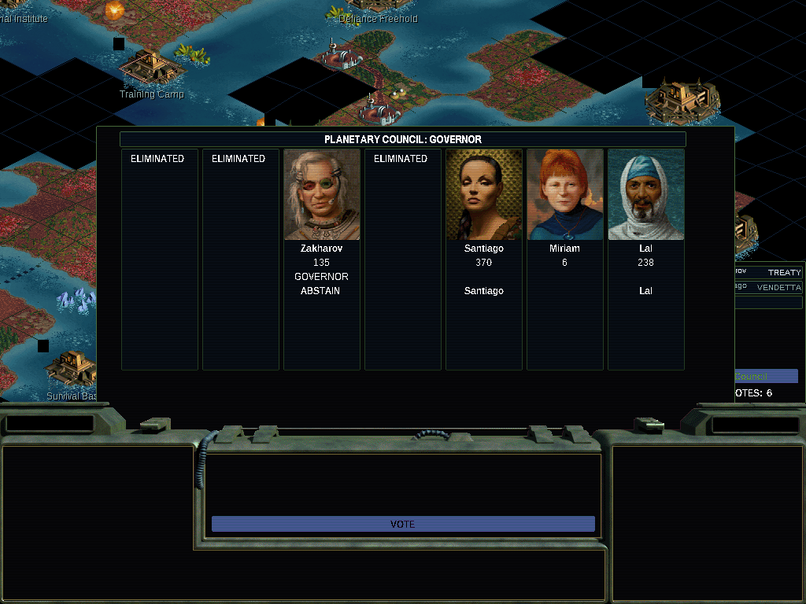

# SMAC/X reconstruction

Goal: reconstruct the source of *Sid Meier's Alpha Centauri: Alien Crossfire*
as portable C++ that builds and runs natively,
and prove behavioural equivalence against the original binary with a differential harness.

## Download and play

Releases (GitHub Releases of this repository) have ready-to-run packages of `smacx`, the native
game with the SDL2 UI. They contain no game data: you need your own installed copy of *Alpha
Centauri* with *Alien Crossfire* v2.0 (GOG's Planetary Pack; `terranx.exe` md5
`cc659f53cb6fa0eaaddccd0a54176647`).

| Package | Run |
| --- | --- |
| `smacx-vX.Y.Z-windows-x86_64.zip` | unzip, run `smacx.exe` (SDL2 DLLs included) |
| `smacx-vX.Y.Z-macos-arm64.zip` | unzip, open `smacx.app` (Apple Silicon, macOS 11+; ad-hoc signed, not notarized: right-click > Open the first time) |
| `smacx-vX.Y.Z-linux-x86_64.tar.gz` | unpack, run `./smacx` (glibc 2.35+, X11 or Wayland; the SDL2 libraries are in `lib/`) |

First run (`src/app/gamedata.cpp`):

1. **Finding the game.** smacx uses the folder it remembered (`smacx.cfg` in the per-user
   directory), else looks in the standard install locations: on Windows GOG's registry entries,
   `C:\GOG Games`, `Program Files`, GOG Galaxy and Steam folders; on macOS GOG's Mac app (a Wineskin
   wrapper: `*.app/Contents/Resources/drive_c/...`) in `/Applications` and `~/Applications`,
   `~/GOG Games`, CrossOver bottles; on Linux `~/GOG Games`, `~/Games` (Lutris, Heroic), Wine prefixes
   (`$WINEPREFIX`, `~/.wine`), Heroic and Bottles prefixes, Steam/Proton. A folder qualifies when it
   has `terranx.exe` v2.0 and the game's data files; another version of `terranx.exe` is reported
   with its md5. If none is found, smacx asks: a message box, then the platform's folder picker
   (Windows: the shell's folder dialog; macOS: `osascript` choose folder; Linux: `zenity` or
   `kdialog` when installed), else a path typed on the terminal. The answer is checked and
   remembered. Without a display or a terminal it exits with status 3 and a message;
   `SMACX_GAMEDIR=DIR` gives the answer in advance, `--gamedir DIR` skips the search.
2. **The data image.** smacx builds the engine's initial data image from the player's
   `terranx.exe` (the C++ port of `src/tools/gen_data_image.py`, byte-identical output) and
   caches it as `data_image.bin` in the per-user directory (`--image` overrides).
3. **Per-user files.** The ini (`Alpha Centauri.Ini`, seeded from the default ini shipped next to
   the executable), saved games (the game's `saves` folder), the Hall of Fame and screenshots go to
   the per-user directory: `%APPDATA%\smacx` (Windows), `~/Library/Application Support/smacx`
   (macOS), `~/.local/share/smacx` (Linux). The game folder is only read.

With `--outdir DIR` (the tests and the harness) none of this happens: the defaults are the
repository's (`game/`, `src/data/data_image.bin`, `harness/oracle/runtime/Alpha Centauri.Ini`),
everything is written below `DIR`, and the ini is copied from `--ini` at every start, so a
stale ini from an earlier run cannot change a test run.

### Making a release

Push a tag: `git tag v1.2.3 && git push origin v1.2.3`. `.github/workflows/release.yml` builds
the three packages (Linux on Ubuntu 22.04, the SDL2 libraries built from source; macOS arm64 on
`macos-14`, an `.app` with the SDL2 dylibs in `Contents/Frameworks`, ad-hoc signed; Windows
cross-compiled with llvm-mingw against the official SDL2 mingw packages) and publishes them as a
GitHub Release (a tag with a `-`, e.g. `v1.2.3-rc1`, makes a pre-release). The repository is
private, so Actions minutes are billed: one release is roughly 65 billed minutes (macOS counts
10x). Running the workflow by hand on a branch builds the packages as workflow artifacts without
a release. `packaging/package.sh` assembles a package and refuses any file outside its
allow-list, so no game data or anything derived from `terranx.exe` can ship.

## Layout

| Path | What |
| --- | --- |
| `game/` | Installed game data (assets, `terranx.exe`). Read-only input. |
| `ref/` | Public reverse-engineering references: Thinker (MIT), OpenSMACX (GPL-3). Used for names/layouts. |
| `tools/` | Downloaded tooling: Ghidra, llvm-mingw (Windows cross compiler), Python venv. |
| `re/` | Analysis: Ghidra project, symbol map, exported decompilation (`re/out/functions.jsonl`). |
| `src/` | The reconstructed game. |
| `tests/` | Portability smoke test (`smacx_smoke`, no game data needed). |
| `harness/` | Differential harness: `oracle/` (DLL injected into the original), comparison tools. |
| `work/` | Scratch run directories, Wine prefix. Disposable. |

## Approach

1. **Inventory**: Ghidra decompiles every function; names come from Thinker/OpenSMACX symbol maps.
2. **Layout-faithful state**: the reconstruction keeps the original 32-bit struct layouts for all
   game state (factions, bases, vehicles, map, rules), with `static_assert`s on sizes/offsets. This
   keeps savegames byte-compatible and lets the harness compare state directly.
3. **Determinism**: the game uses MSVC `rand()` (214013/2531011 LCG) and its own LCG
   (1664525/1013904223). Both are reimplemented bit-exactly; the harness pins the seeds that the
   original derives from the clock.
4. **Differential harness**: the original runs under Wine + Xvfb with `oracle.dll` injected. The DLL
   pins seeds, sets up a game non-interactively, runs all-AI turns and writes a save + RNG state after
   every turn. The reconstruction runs the same scenario headless and writes the same artifacts.
   `harness/compare` diffs them field by field and reports the first divergence.

## Tooling (all local, no system installs)

| Tool | Location | Notes |
| --- | --- | --- |
| Ghidra 12.1.4 | `tools/ghidra_12.1.4_PUBLIC` | Project in `re/ghidra_proj`; scripts in `re/ghidra_scripts` (`ApplySymbols`, `ExportAll`). |
| llvm-mingw 20260922 | `tools/llvm-mingw-*` | Windows cross compiler: i686 for `oracle.dll`/`hybrid.dll` (`cmake/i686-mingw.cmake`), x86-64 native builds (`cmake/x86_64-mingw.cmake`). |
| Python venv | `tools/venv` | pefile, capstone, pillow, numpy, mss. |
| SDL2 2.30.11 + SDL2\_ttf 2.24.0 | `tools/sdl2` | Built from source (`tools/SDL2-*`); X11/ALSA loaded dynamically. Headers for the build came from Debian `-dev` packages unpacked into `tools/sysroot`. |
| Wine prefix | `work/wineprefix` | Private; crash debugger disabled. |

## Builds

```sh
cmake -S . -B build/native && cmake --build build/native -j2          # engine + smacx_headless
cmake -S . -B build/hybrid -DSMACX_HYBRID=ON -DCMAKE_TOOLCHAIN_FILE=cmake/i686-mingw.cmake
cmake --build build/hybrid -j2                                         # oracle.dll, hybrid.dll, oracle_launch.exe
```

The native build needs CMake 3.20+, Python 3 (it generates the original-function bindings) and a
C++17 compiler with `<filesystem>`. Game data is only needed at run time: `smacx_headless` reads
`game/` and `src/data/data_image.bin` (see "Getting started"). `smacx_smoke` (`ctest`) is a
portability self-test that needs no game data; `smacx_unit` (`ctest`, doctest) holds the engine's
unit tests. Cleanup work (docs/CLEANUP_PLAN.md) is gated by `src/tools/gate.sh`.

**macOS** (Xcode command line tools, CMake from Homebrew or cmake.org; Apple Silicon or Intel):

```sh
cmake -S . -B build/native -DCMAKE_BUILD_TYPE=RelWithDebInfo
cmake --build build/native -j8 --target smacx_headless smacx_smoke smacx_unit && ctest --test-dir build/native
```

**Windows**: MSYS2 with the CLANG64 (or UCRT64) environment is the supported toolchain:

```sh
pacman -S mingw-w64-clang-x86_64-{clang,cmake,ninja,python}
cmake -S . -B build/native -G Ninja -DCMAKE_BUILD_TYPE=RelWithDebInfo -DCMAKE_EXE_LINKER_FLAGS=-static
cmake --build build/native --target smacx_headless smacx_smoke smacx_unit && ctest --test-dir build/native
```

Cross-compiling from Linux with the local llvm-mingw: `-DCMAKE_TOOLCHAIN_FILE=cmake/x86_64-mingw.cmake`
(64-bit) or `cmake/i686-mingw.cmake` without `SMACX_HYBRID` (32-bit native, runs under 32-bit Wine).
Run `smacx_headless` from the repository root (or pass `--gamedir`, `--image`, `--ini`).

### Compilers

The reconstruction keeps the original's MSVC/x86 semantics (signed overflow wraps, no type-based
aliasing, signed `char`, no fused multiply-add, out-of-bounds table reads kept as in the original);
`CMakeLists.txt` sets the flags (`-fwrapv -fno-strict-aliasing -fsigned-char -ffp-contract=off`,
GCC also `-fno-aggressive-loop-optimizations`). Targets must be little-endian (x86, x86-64, arm64).

| Compiler | Targets | Status |
| --- | --- | --- |
| GCC 9+ (tested 14) | Linux x86-64 | reference build; matches the original on all harness scenarios |
| Clang 10+ (tested 23) | Linux x86-64 | matches (tiny20, small12, std8, late140, council131) |
| llvm-mingw / MSYS2 clang (libc++) | Windows x86-64, i686 | builds; the i686 build matches under Wine (same five scenarios) |
| Apple clang | macOS arm64 / x86-64 | built and smoke-tested in CI |
| MSVC (cl.exe) | Windows x86-64 | experimental (CI, allowed to fail); not verified against the original |

CI (`.github/workflows/build.yml`) builds `smacx_headless` and runs `smacx_smoke` on all of these.

## Status

The engine is reconstructed: `smacx_headless` plays complete AI-only games natively (no original
code, no Wine) and its game state matches the original's after every turn on all 19 harness scenarios
(`harness/scenarios/`, from tiny maps to 300-turn games through Planetary Council sessions and the
end of the game). Progress per function: `build/*/generated/status.tsv`.

The user interface (SDL2 port of the original windows, map view and dialogs; target `smacx`) covers
the whole single-player game: main menu and game setup, the map with 3D units, unit orders, the
base window, research, the design workshop, social engineering and the reports, diplomacy and the
Planetary Council, Datalinks, load/save, preferences, sound, music and movies. What is still
approximated or missing is listed in `docs/UI_PLAN.md` section 13; multiplayer is not supported.
Audio and video are supported: sound effects, voices (MP3), music and the game's movies (.wve).

Screenshots of `smacx` (native, no original code):

| | |
|---|---|
|  |  |
| Map: bases and developed land, turn 300 | Base window: resources, citizens, production |
|  |  |
| Diplomacy: an AI leader calls | Design workshop with the 3D unit preview |
|  | |
| Planetary Council election | |

## Playing on macOS

1. Tools: Xcode command line tools (`xcode-select --install`) and Homebrew, then
   `brew install cmake sdl2 sdl2_ttf python`.
2. Game files: `game/` must hold the installed game (the same files as the Windows install, with
   `game/terranx.exe` v2.0, md5 `cc659f53cb6fa0eaaddccd0a54176647`). Either copy `game/` from a
   machine where it is installed, or take the game folder out of the GOG Mac app (a Wineskin
   wrapper: right-click the app, Show Package Contents, then `Contents/Resources/drive_c/...`, the
   folder that contains `terranx.exe`).
3. Data image (only for `smacx_headless` and `--outdir` runs; `smacx` alone builds its own):
   `python3 src/tools/gen_data_image.py game/terranx.exe src/data/data_image.bin`.
4. Build and run from the repository root:

```sh
make run                                 # configure, build, start the game (main menu)
```

The `Makefile` wraps CMake (`make`, `make run`, `make test`, `make clean`; `BUILD=dir`,
`CMAKE_ARGS=...`). It also works around macOS Command Line Tools betas whose compiler can't find
its own C++ headers. The equivalent CMake commands:

```sh
cmake -S . -B build/native -DCMAKE_BUILD_TYPE=RelWithDebInfo
cmake --build build/native -j8 --target smacx
build/native/smacx                       # main menu; or: --new --human 1, --save FILE.SAV
```

CMake builds `smacx` only when it finds SDL2 and SDL2\_ttf (the configure step prints a message
otherwise). Run without `--outdir`, smacx finds the game and keeps its settings and saves in the
per-user directory as a released build does ("Download and play"); with `--outdir DIR` it uses
`game/` and `src/data/data_image.bin` from the current directory and writes below `DIR`.

## Getting started

Not in the repository (copyrighted or regenerable): the game, the installers, tools, reference
projects and generated analysis. To recreate them:

1. Install the game files into `game/` (GOG Alpha Centauri Planetary Pack; `game/terranx.exe` must be
   v2.0, md5 `cc659f53cb6fa0eaaddccd0a54176647`).
2. Data image for native builds:
   `python3 src/tools/gen_data_image.py game/terranx.exe src/data/data_image.bin`
3. Reference projects (names/layouts): `git clone https://github.com/induktio/thinker ref/thinker`
   and `git clone https://github.com/b-casey/OpenSMACX ref/OpenSMACX`.
4. Analysis (needed for reconstruction work, not for building): download Ghidra into `tools/`, then
   `python3 re/scripts/extract_symbols.py`, run `analyzeHeadless re/ghidra_proj terranx -import
   game/terranx.exe -scriptPath re/ghidra_scripts -preScript ApplySymbols.java re/out/symbols.tsv
   -postScript ExportAll.java re/out/functions.jsonl`, then `python3 re/scripts/split_funcs.py` and
   `objdump -d -M intel --start-address=0x401000 --stop-address=0x664000 game/terranx.exe >
   re/out/terranx.asm`.
5. The differential harness additionally needs Wine, Xvfb and llvm-mingw (Linux).
